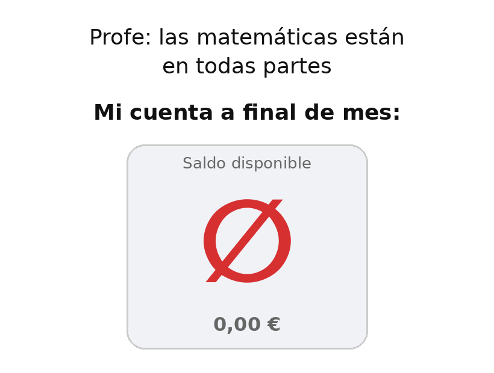

Quinta sesión, ya metidos en el tema 4: recursos educativos en Educación Matemática. Y empezamos por la pregunta más difícil de todas: ¿cómo enseñar dónde están las matemáticas en el día a día? La típica pregunta que siempre hemos hecho todos: ¿profe, pero esto para que sirve?

## Lo que hemos visto

La respuesta de la sesión fue **las matemáticas "invisibles"**: todas esas que están a nuestro alrededor y que usamos sin darnos cuenta. Desde el dígito de control de un código de barras o la letra del DNI hasta cómo se mide la frontera entre dos países, que cambia según lo fina que sea la regla que uses.

También salió una idea que me gustó mucho: cuando nombramos a matemáticos famosos solemos quedarnos en la fecha y el teorema, pero muchos de ellos trabajaban en **problemas muy reales**. Newton estudió el movimiento de la Luna para ayudar a los marineros a situarse en el mar, Euler diseñó mástiles de barcos y Gauss trabajó en el telégrafo. Contado así, interesa bastante más.

La segunda parte de la sesión fue un repaso de repositorios y recursos: Procomún, eXeLearning, el Proyecto EDIA, el Proyecto Descartes, GeoGebra y un montón de blogs y canales de profesores que comparten lo que hacen.

## El mundo con mirada matemática

Fue la parte que más disfruté. La idea es sencilla: **salir a la calle y mirar con ojos de matemático**. Vimos ejemplos de lo más variado:

- La **sucesión de Fibonacci** en neón subiendo por la cúpula de la Mole Antonelliana de Turín, obra de Mario Merz, y la misma idea en una chimenea industrial de Finlandia.
- Las esculturas de **Keizo Ushio**, que talla bandas de Möbius en granito.
- Los dibujos gigantes de **Jim Denevan** en la arena y en el hielo del lago Baikal, hechos con círculos.
- El **turismo matemático** y los **paseos matemáticos**: rutas por una ciudad buscando geometría en fachadas, suelos y monumentos.
- **MathCityMap**, una aplicación para diseñar tu propia ruta matemática y que los alumnos la recorran resolviendo problemas en cada parada.

Me parece una de las formas más potentes de responder al eterno "¿y esto para qué sirve?". No hace falta inventarse un problema con trenes que salen a la vez de dos estaciones: basta con salir del aula y mirar. Además, encaja con lo que veíamos en la sesión de neurodidáctica: moverse, salir del contexto habitual y descubrir algo por uno mismo es de lo que mejor se queda en la memoria.

Eso sí, tiene un efecto secundario: una vez que empiezas a verlas, ya no puedes dejar de hacerlo.

## Troncho y Poncho

Entre los recursos de profesores apareció **Angelitoons**, el proyecto de Ángel, un profesor de matemáticas de Madrid que en sus ratos libres hace animaciones protagonizadas por **Troncho y Poncho**, dos personajes que explican matemáticas (y física, y lo que haga falta) con mucho humor. Vimos también un reportaje del telediario sobre él, que dejaba una frase para apuntar:

> "Quien utiliza el humor para enseñar es que se toma la educación muy en serio."

Creo que tiene toda la razón. El humor baja la tensión, y si algo nos dejó claro la sesión anterior es que un cerebro estresado aprende peor. Un vídeo corto y gracioso al empezar un tema puede hacer más por la actitud de un grupo que diez minutos de "esto es muy importante, chicos".

## Meme de la sesión

Siguiendo el espíritu de Troncho y Poncho, aquí va mi aportación:

## Material

El reportaje sobre Troncho y Poncho:


